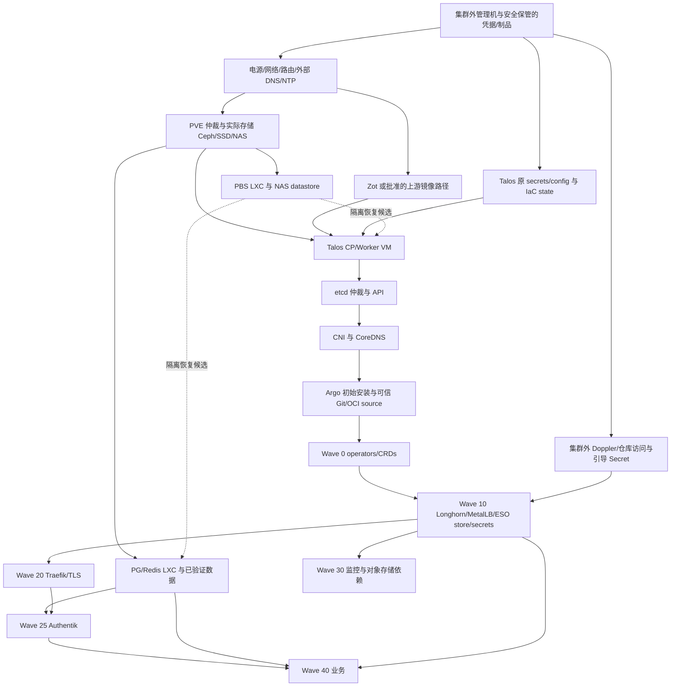

# HOM-9：Talos Day-0、故障域与恢复证据

本交付完成只读取证和 runbook 草案。**尚未证明整套环境可以从备份恢复，也未测得 RTO。**
六台 Talos VM 的宿主分布、近期 PBS 成功记录已核实；etcd 快照保管、备份校验、
隔离恢复、数据库一致性及 NAS 外副本仍待补齐。没有执行 bootstrap、apply、创建备份、
故障注入、数据恢复、集群写入或合并。

- [当前证据与故障域](#当前证据与故障域)
- [Day-0 与整站冷启动草案](day0.md)
- [恢复分流、证据清单与 RPO/RTO](recovery.md)
- [字段化观测与只读命令](observed.json)

## 版本、时间与证据等级

本轮为上海时间 **2026-11-06**。观测时间以 `observed.json` 每项的 UTC 起止时间为准，
各次 GET 非原子快照。执行者：Mika；执行面：本地管理机，经既有 kubeconfig/talosconfig
及已配置 SSH 密钥访问；没有读取 Doppler/Secret 值或导出 Terraform state。

| 等级 | 含义 | 本轮基线 |
| --- | --- | --- |
| 现场 | 此次成功只读查询，不能外推到故障期间 | `observed.json` 的命令、退出码、筛选字段和时间 |
| 声明 | Git 中期望配置，不能代替运行证据 | Talos IaC main `1cc7690082058c603632709dc259136221bd21ab`；PVE main `0efd161a1cbcf517f8c5be53961975a4ff882868` |
| 历史 | 先前任务或个人笔记，未获本轮验证的内容保持历史标签 | HOM-6；HOM-7 #138；HOM-8 #139；旧 Talos/Argo bootstrap 笔记 |
| 推断 | 根据已观测拓扑推导影响，未作故障演练 | 下方宿主/API/DNS 失效分析 |

声明的可定位来源：PVE
[VM 分布](https://github.com/loushomelab/homelab-pve/blob/0efd161a1cbcf517f8c5be53961975a4ff882868/vms/main.tf)、
[备份任务](https://github.com/loushomelab/homelab-pve/blob/0efd161a1cbcf517f8c5be53961975a4ff882868/vms/storage.tf)、
[迁移忽略规则](https://github.com/loushomelab/homelab-pve/blob/0efd161a1cbcf517f8c5be53961975a4ff882868/modules/proxmox-vm/main.tf)、
[Talos 配置与 bootstrap](https://github.com/loushomelab/homelab-pve/blob/0efd161a1cbcf517f8c5be53961975a4ff882868/talos/main.tf)。
GitOps 的 root/tier、引导 store、Longhorn 和监控源位于此 PR 基线的
`argocd/bootstrap/`、`argocd/configs/security/external-secrets/`、
`argocd/apps/infrastructure/10-core/longhorn.yaml`、`argocd/apps/monitoring/`。

从新获取的远端 main 创建独立分支；保留用户现有工作区。PVE 本地 HEAD 为 `2f93b4f`，
已过时，本报告声明以获取后的远端 `0efd161` 为准，没有切换或修改 PVE 工作区。
特别是 `vms/storage.tf` 已改为显式 guest 清单、排除 PBS 自身，并将 NFS server 改为 `.102`；
不再把旧 `all=true`、`.76` 作为现状。

前置设计仍是未合并 PR：[HOM-7 #138](https://github.com/loushomelab/homelab-talos-iac/pull/138)
（`2ee64a9fd209abe490f3157f77183f805c4aa517`），
[HOM-8 #139](https://github.com/loushomelab/homelab-talos-iac/pull/139)
（`894ace8c0a65c2c3a25a1c388188e1f83351cded`）。本 PR 独立基于 main，未叠加两者。
HOM-8 的 [NAS/S3 门禁及恢复顺序](https://github.com/loushomelab/homelab-talos-iac/blob/894ace8c0a65c2c3a25a1c388188e1f83351cded/design/monitoring-recovery/README.md)
与 [功能验收](https://github.com/loushomelab/homelab-talos-iac/blob/894ace8c0a65c2c3a25a1c388188e1f83351cded/design/monitoring-recovery/acceptance.md)
作为历史设计引用，不能当成 main 已有工具或本轮已完成的恢复审批。

## 当前证据与故障域

| 对象 | 本轮现场证据 | 仍不能证明 |
| --- | --- | --- |
| Talos/K8s | 六节点 Ready；Talos v1.13.8 / K8s v1.36.0；PVE 六 VM running | 冷启动或宿主宕机后的恢复成功 |
| etcd | 三个非 learner 成员，三个查询视角一致；leader cp-02，status 无 errors | 有离线可用快照、快照新鲜度或恢复成功 |
| API | kubeconfig 指向 `https://192.168.50.114:6443`；`.110/.112/.114` 的认证 `/readyz` GET 均 `ok` | VIP/自动切换或故障时客户端重试成功 |
| CoreDNS | 两个 ready EndpointSlice 地址，nodeName 均为 cp-01 | 跨 CP/跨宿主容灾；没有作 DNS 故障注入 |
| Argo | root、tier 当前 Sync SHA 为本轮 IaC main；未配置 Application health override | wave 已传递子应用就绪；业务及数据健康 |
| PBS 任务 | 三宿主最近四条 vzdump 均 OK；最新一批始于 `2026-11-04T18:00Z`（上海 11-05 02:00） | 每个磁盘、数据库和卷应用一致且可恢复 |
| PBS 内容 | 六 Talos VM、CT 151/152/153/125/200/201 等有上述批次 snapshot；PBS 端相应 backup task OK | chunk 校验、隔离恢复、NAS 外保护 |
| PBS 校验 | verify-job 列表为空；近期 40 条 task 内没有 verify 成功记录 | 不能断言从未手工校验；本轮未取得校验成功证据 |
| Longhorn | 7 卷 attached/healthy，期望副本数均 3；21 个 replica 的现场 nodeID 已记录 | 三个物理故障域、独立备份或跨 VM 快照一致性 |
| Longhorn 备份 | Backup/RecurringJob 均 0，volume lastBackup 为空 | 不代表 PBS 或仓库外保护不存在 |
| 引导凭据 | `doppler-token-global` 元数据存在；store Ready/Valid，ExternalSecret 状态见证据 | 集群全损后还能取回外部凭据；未导出值 |
| 监控 | Mimir 后端及 Pyroscope 已有 ready 副本；Alloy DS 3/3；内置 pyroscope-alloy 0 | 历史数据完整、S3 灾备已通过或未来恢复获准 |

**HOM-8 的零副本/503/旧 NAS 不可达是 10 月 30 日历史观测。** 当前 main 和 workload
观测已变化，不能据旧结论声称仍在维护。本轮没有复测 HTTP、认证 S3、NAS pool/磁盘健康，
也未核对造成这次恢复的完整审批链；不把现有运行状态解释为本任务获准恢复。
main 中 Mimir 仍声明 RF=1、ingester/store-gateway/compactor 无 PVC；不要因三个 zone
或 Pod Ready 就假定有三副本数据保障。

### 物理宿主映射与共故障依赖

PVE `/cluster/resources --type vm` 实测，与当前 Terraform 的六 VM 分布一致。
`modules/proxmox-vm/main.tf` 忽略 `node_name` 变化，因此将来必须重复查询，不能只读 HCL。

| PVE 宿主 | Talos VM | 其他本轮确认的关键 guest | 单宿主失效推断 |
| --- | --- | --- | --- |
| r720 | 110 cp-01、111 worker-01 | — | 丢一个 etcd 成员及当前两个 CoreDNS 端点；卷副本受影响 |
| 1920x | 112 cp-02、113 worker-02 | 125 Zot registry | 丢一个 etcd 成员及镜像缓存；无法保证冷启动镜像获取 |
| 3960x | 114 cp-03、115 worker-03 | 151 auth-pg、152 obs-pg、153 auth-redis、154 PBS、200 TF agent、201 runner | 当前 kubectl 单入口、DB、备份服务和部分交付控制面同时失效 |

CT 151/152 rootfs 位于 `Ceph-pool`，本轮未核对 PGDATA、WAL、tablespace 或 Ceph OSD/host
分布、pool 副本及仲裁。guest 当前宿主不等于底层存储故障域。HA 标记也不能证明故障后迁移可用。
PVE 的电源、交换机、路由、Ceph、NAS 的共同故障域尚未核实。

Longhorn 的 `pulse-pvc` 三个 running replica **全部在 worker-03（3960x）**；
`dind-storage-forgejo-runner-0` 为 worker-01 两个、worker-02 一个。其余五卷各跨三 worker。
因此不能把“7 卷 healthy、replicas=3”写成全部能耐受任一宿主失效。此 PR 只记录风险，
不调度/迁移/修复副本；要修复须另列容量、数据风险、字段 diff 和获准实施计划。

### PBS 的实际数据路径

现场链路：`pbs-lxc` → PBS datastore `pbstorage` → CT154 `/mnt/datastore/pbstorage`
（ext4 `/dev/loop0`）→ `mp0=pbstorage:154/vm-154-disk-1.raw`（`backup=0`）→
PVE NFS `192.168.50.102:/mnt/tank/pbstorage`。PBS rootfs 在 `Ceph-pool`。

当前 job 是显式 guest 清单，不含 154；其可见最新旧 snapshot 为 `2026-08-25T18:01:57Z`。
**恢复 PBS 系统盘不等于恢复 2 TB 数据盘中的 chunks。** 没有取得 NAS 外 datastore 副本、
NAS pool/SMART、PBS 配置/密钥保管或隔离恢复证据。NFS 可读目录和成功 backup task
不能证明 NAS 本身无风险。也未核对当前 S3 endpoint，不推定 S3 与 PBS 必然位于同一 pool。

六 VM 的磁盘配置 GET 见 `vm_disks_*`：系统盘 `SSD`、worker 100 GiB，六台 `scsi0` 都显式 `backup=1`。这支持备份覆盖候选，不能替代 backup manifest 与恢复后数据校验。

## 冷启动依赖图

实线表示需要检查的依赖；波次为 Git 声明的创建顺序，不是就绪证明。

避免环依赖：管理机不能只依靠集群内 DNS/SSO；Doppler token 不能只存在待恢复的 ESO
Secret；私有 Git 凭据不能只保存在待恢复的 Forgejo；PBS 登录及 NFS 定位不能只靠待恢复
Authentik/DNS；Terraform agent 在 3960x，需要预先审核集群外执行替代路径。
Zot 当前在 1920x，PVE DNS HCL 声明 `198.18.0.2`；实际解析器、代理和上游镜像回源策略
仍待只读核验，不把本地镜像缓存当作永久可用制品仓库。

## API 与 DNS 故障影响（拓扑推断，未演练）

三 etcd 成员在不同宿主，正常连通条件下允许一个成员失效；失去多数则 API 写操作无法继续。
然而 cp-03 失效时当前 kubeconfig 入口先失效，即使另两个成员保持仲裁；cp-01 失效时
当前两个 CoreDNS 端点同时消失，会影响 Service 名称解析、ESO 外连及应用重连。
DNS 缓存和已有 TCP 连接可能短时掩盖影响，不能依靠它验收 HA。

PVE `talos/variables.tf` 的默认 cluster endpoint 为 cp-01 `.110`；实际 HCP override/运行
machineconfig endpoint 未读取。Talos 客户端有三个 CP endpoint 与 kubectl 单入口是不同层。
未在所审 HCL 中找到 API VIP，不等于证明所有外部 LB 都不存在；Traefik/MetalLB 的业务 VIP
也不是 API 自动切换证据。

可用现有 CA/凭据对备用 CP 做只读 `/readyz`，本轮三个都成功；实际切换方案还需确认 SAN、
路由、客户端分布和失效时重连，不能通过永久改写 kubeconfig 或停节点来补本任务证据。
CoreDNS 跨物理故障域调度、API 稳定入口、PG/PBS/agent 共宿主隔离是后续方案项。

## 复核与交付边界

`observed.json` 保留成功 GET 的命令和字段，读者可在有相同权限的私密环境重跑；
复核时必须保持字段筛选，不向公开日志打印 Secret、machineconfig、state 或完整集群 dump。
PVE/Longhorn 的身份映射和 PBS 路径应与 [恢复证据清单](recovery.md) 一起复核。

本地验证已通过：38 项只读查询退出码均为 0；JSON 解析、Markdown 围栏/本地链接、
冲突标记、私钥/token/email 模式扫描、`git diff --cached --check`，以及
`pre-commit run --all-files` 的全部八项检查（包括 YAML 与 Renovate 配置验证）。
文档没有修改 manifest/Helm/Terraform，不运行 workload apply/dry-run 或同步/清理 Taskfile 入口。
文档 PR 不修改 GitOps 资源，
无需也不声称 Argo 已部署本 PR 的 SHA。最终记录实际执行的验证，不以外部 CI 结束作为交付前提。
可复用知识已沉淀在本目录；个人 Obsidian 笔记仅检索，没有修改。
